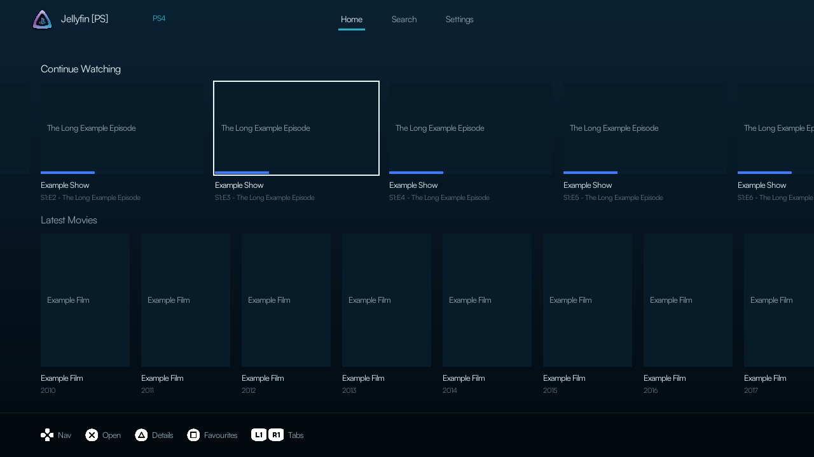
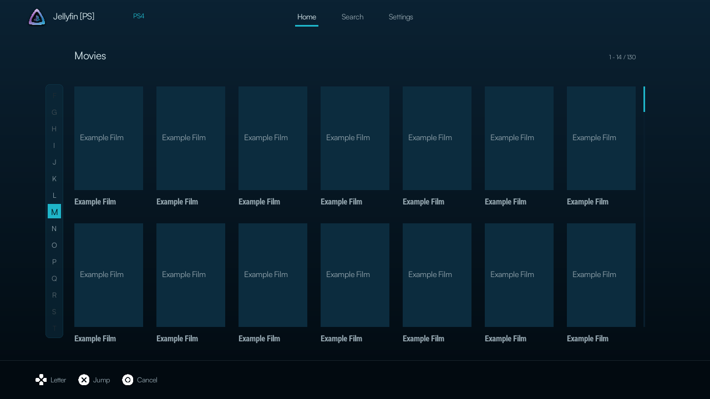
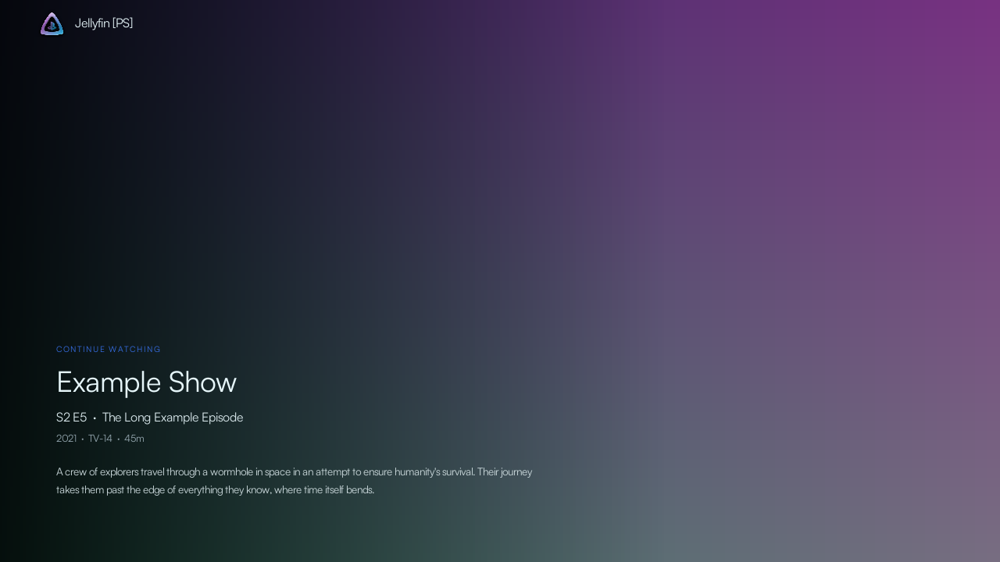

# Jellyfin [PS] for PS4

A native Jellyfin client for jailbroken PS4 consoles, built with the OpenOrbis toolchain. It brings the Classic layout of Jellyfin [PS] to the PS4: library browsing, a full details page, Live TV, a screensaver and MPV/FFmpeg playback.



## Features

- **Home**: My Media, Continue Watching, Next Up and the latest movies, shows and music, each row scrolling on its own.
- **Libraries**: two-row poster grids with an A–Z jump bar (press Left at the first column), quick peek (Triangle) and fast paging. The next page is fetched in the background.
- **Details page**: backdrop, poster, rating, quality chips, Resume / Play from start / Favourite / Watched, version, audio and subtitle selection, synopsis, genres, director and the cast as photo cards. Select an actor to see their filmography.
- **Live TV**: a channel grid with logos and what's on now, categories (L2 / R2), Favourites and Recently watched, a three-hour guide (Square) and channel search (touchpad).
- **Player**: on-screen bar with title, progress and times. Left / Right scrub, L2 / R2 skip five minutes, X pauses, Square hides the bar.
- **Screensaver**: full-screen artwork from Home with title and synopsis. Turn it on or off and set the delay in Settings.
- **Sign-in**: server URL with a real connection check, then Quick Connect or username and password. Sessions and settings are saved per PS4 user.
- Startup animation, controller-icon hints throughout, themes, and Settings > About.

| | |
|---|---|
|  |  |
|  |  |

## Install

1. Copy `dist/v1.09/IV0000-JFPS40000_00-JELLYFINPS400000.pkg` to your PS4 and install it with your package installer.
2. Open **Jellyfin [PS]**, enter your server's full URL including the port (for example `http://192.168.1.100:8096`), then sign in with Quick Connect or your username and password.

## Controls

| Button | Action |
|---|---|
| D-pad | Move |
| X | Open / select / play |
| Circle | Back |
| Triangle | Quick peek (libraries), favourite (Live TV) |
| Square | Favourites (Home), guide (Live TV), hide bar (player) |
| L1 / R1 | Home, Search, Settings |
| L2 / R2 | Live TV category, skip five minutes in the player |
| Options | Settings |
| Touchpad | Refresh Home, search channels (Live TV) |

## Playback

Video is requested from the server as H264/AAC HLS up to 1280×720 and decoded in software by MPV/FFmpeg; audio is stereo at 48 kHz. Unsupported files need transcoding permission on the server. A direct-file setting is available for compatible MP4s. Audio and subtitle tracks are chosen on the details page before playing.

## Files on the console

- Settings, session and logs: `/data/JellyFin-PS4/user-<id>/`
- Diagnostic log (no passwords or tokens): `/data/JellyFin-PS4-logs/user-<id>.log`
- Extra themes: `/data/JellyFin-PS4/themes/`
- Put `0` in `bootanim.txt` in the user folder to turn the startup animation off.

## Building

From PowerShell in this folder:

```powershell
.\tools\build.ps1
```

This uses a WSL distribution (`kali-linux` by default) with Clang 18 and the project-local OpenOrbis toolchain and PS4 port libraries under `tools/`. The package is written to `dist/<version>/` and validated. Host-side tests and previews are under `tests/` and `tools/test_*.sh`.

## Credits and licence

Made by jw-notes. Jellyfin [PS] is free software under the GNU GPL, version 3 or later; see `LICENSE`.

Playback uses the PS4 builds of MPV (GPL 2+) and FFmpeg (LGPL / GPL 3) from [Switchfin](https://github.com/dragonflylee/switchfin/tree/ps4) (Apache 2.0), with SDL2, mbedTLS, dav1d, libass, FreeType, FriBidi, libpng, zlib and bzip2 under their own licences. Fonts: Satoshi (ITF Free Font License), Open Sans and Roboto Condensed (Apache 2.0), Noto Sans JP (SIL OFL 1.1). Button sprites by Kenney (CC0). Jellyfin logo CC BY-SA 4.0.
