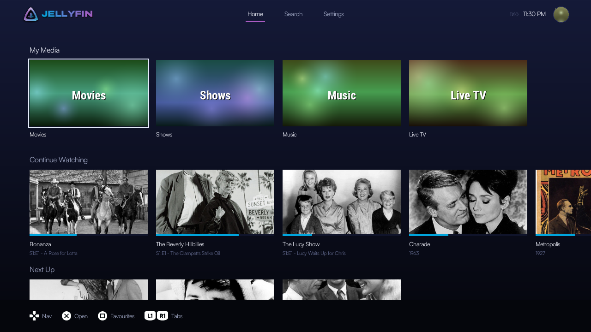
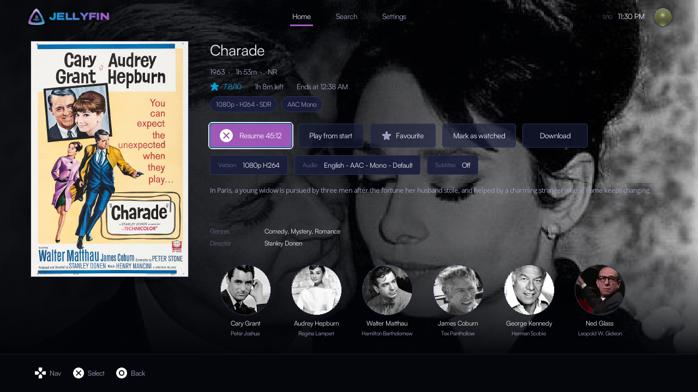
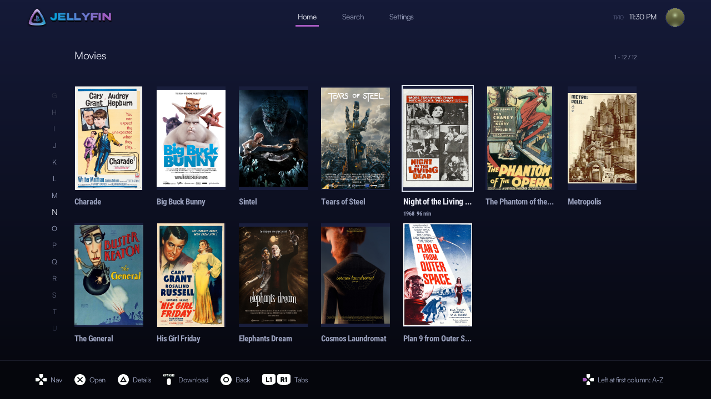
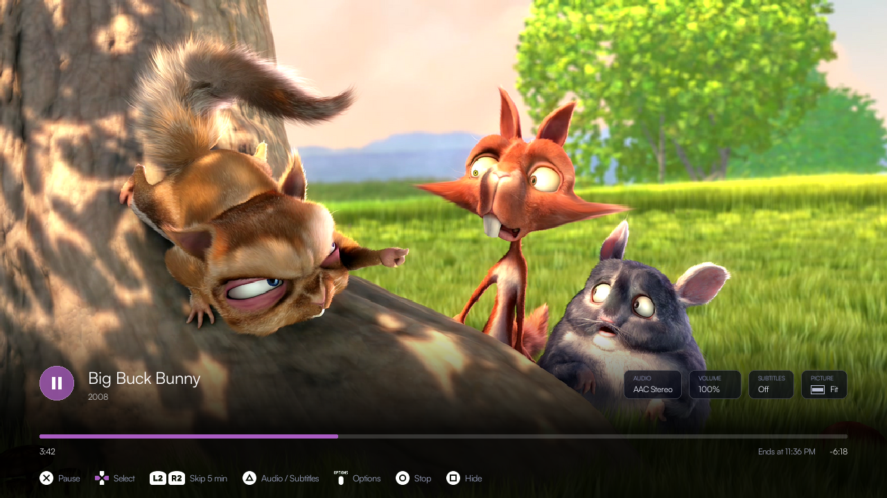
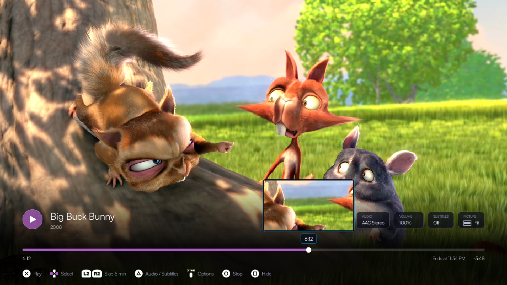
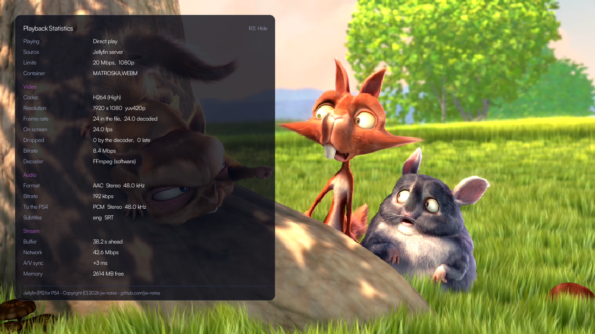
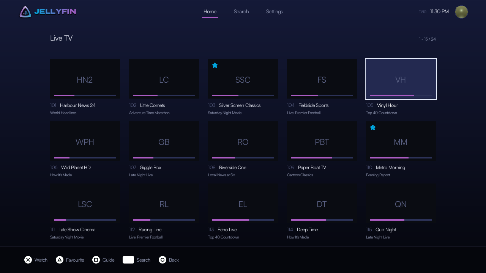
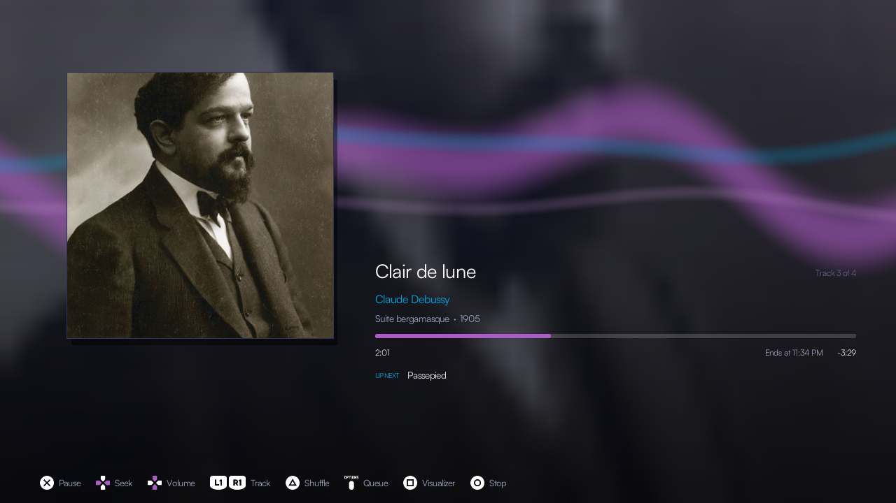
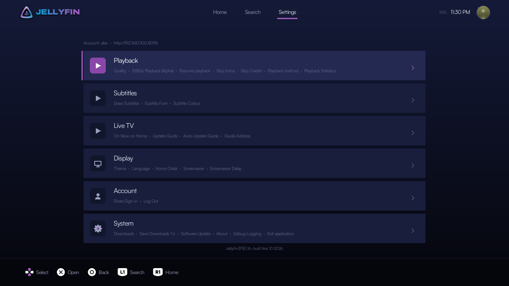

<div align="center">
  

  <h1>JellyFin [PS] for PS4</h1>

  <p>
    <a href="https://github.com/jw-notes/JellyFin-PS4/releases/latest"></a>
    
    
    <a href="LICENSE"></a>
  </p>

  <b><a href="https://github.com/jw-notes/JellyFin-PS4/releases/latest">Download the latest release</a></b>
</div>

<br>

**JellyFin [PS] is a native, open-source Jellyfin app for PlayStation.** Watch your films, shows, music and Live TV from your own Jellyfin server on a PS4, with the Classic layout of [JellyFin [PS] for PS3](https://github.com/jw-notes/JellyFin-PS3). Made by [jw-notes](https://github.com/jw-notes), free software under the GPL.



## What you need

- A PS4 that runs homebrew (GoldHEN), on firmware 13.52 or 14.00. For USB drives, GoldHEN 2.3 or later.
- A Jellyfin server, version 10.11 or 12, that the PS4 can reach on your network.

## Install

1. Download `IV0000-JFPS40000_00-JELLYFINPS400000.pkg` from the [latest release](https://github.com/jw-notes/JellyFin-PS4/releases/latest).
2. Copy it to the PS4 and install it with the Package Installer (Debug Settings › Game › Package Installer).
3. Open **Jellyfin [PS]** and type your server's address with its port, for example `http://192.168.1.100:8096`.
4. Sign in with **Quick Connect** (approve the code in Jellyfin on your phone or PC) or your username and password.

**Updating:** the app checks for a new version every time it starts. Settings › System › **Software Update** downloads it to `/data/pkg`; install it from the Package Installer. Your sign-in and settings are kept.

## What it does

- **Films and shows** with resume, Next Up, intro and credits skipping, and autoplay of the next episode.
- **Music** with albums, artists, playlists, genres, shuffle, a queue and four visualizers.
- **Live TV** with a channel grid, favourites, a guide and channel search.
- **Search** that updates as you type.
- **Subtitles** in SRT, VTT, ASS and PGS, including Chinese, Japanese, Korean, Hebrew, Arabic and Persian.
- **Downloads** to the console or a USB drive, to watch without the server.
- **USB drives**: play video and music straight from a drive, no server needed.
- **Seek previews**: a picture of the scene while you scrub, for films from the server, a USB drive or a download.
- **Chapters**: marked on the progress bar, named while you scrub, a list with a picture of each (Options), and L2 / R2 to jump between them, as on a Blu-ray player.
- **Playback statistics**: press R3 while playing to see the codec, frame rate, dropped frames and whether the file is played directly or converted.
- Six languages, themes, a screensaver, and one sign-in shared between the console's users.

| | |
|---|---|
|  |  |
|  |  |
|  |  |
|  |  |

## Help

<details>
<summary><b>Controls</b></summary>

<br>

**Everywhere**

| Button | Does |
|---|---|
| D-pad | Move |
| X | Select / open / play |
| Circle | Back |
| L1 / R1 | Switch between Home, Search and Settings |

**Home**

| Button | Does |
|---|---|
| Triangle | Quick look (details and cast) |
| Square | Favourites |
| Touchpad | Refresh |

**Libraries**

| Button | Does |
|---|---|
| Triangle | Quick look (details and cast) |
| Options | Download what is highlighted (a film, episode, season, album or song) |
| Left (on the first column) | A-Z jump bar: pick a letter, X jumps to it |
| Circle | Back, or clear the letter you jumped to |

**Details page**

| Button | Does |
|---|---|
| X | Resume, Play from start, Favourite, Watched, Download, or change version, audio and subtitles |
| X on an actor | Their filmography |

**Search**

| Button | Does |
|---|---|
| X | Type a letter |
| Square | Delete a letter (or remove a recent search) |
| Triangle | Caps |
| L2 / R2 | Move the cursor; on the results, filter by Films, Shows, Episodes, Albums, Songs... |
| Options | Hide the keyboard and show the results |
| Circle | Clear what you typed, or bring the keyboard back |

**Watching a film or show**

| Button | Does |
|---|---|
| X | Pause / play, or use the highlighted control |
| Left / Right | Scrub (hold to go faster); a preview of the scene shows above the bar |
| Up / Down | Move between the scrub bar and the controls (Play, Volume, Picture) |
| L2 / R2 | Previous / next chapter (or 5 minutes back / forward when the film has none) |
| Options | Options: Chapters, Audio / Subtitles, Picture, Playback Statistics; for a show also Next / Previous Episode and Skip Intros / Credits |
| L1 / R1 | Previous / next episode |
| Triangle | Audio and subtitles, or Skip Intro / Skip Credits when it shows |
| Square | Hide the bar |
| R3 (press the right stick) | Playback statistics on / off |
| Circle | Stop |

**Picture (size and shape)**

| Button | Does |
|---|---|
| D-pad | Change the size, or the position |
| R1 | Switch between size and position |
| Square | Fit / Fill / Stretch |
| Triangle (hold) | Reset |
| Circle | Done |

**Music**

| Button | Does |
|---|---|
| X | Pause / play |
| Left / Right | Seek |
| Up / Down | Volume |
| L1 / R1 | Previous / next track |
| Triangle | Shuffle on / off |
| Options | The queue: pick any track to play |
| Square | Change the visualizer |
| R3 | Playback statistics on / off |
| Circle | Stop |

**Live TV**

| Button | Does |
|---|---|
| X | Watch the channel |
| Triangle | Add to / remove from Favourites |
| Square | The guide |
| L2 / R2 | Change category |
| Touchpad | Search channels |

**Watching Live TV**

| Button | Does |
|---|---|
| Up / Down | Volume |
| L1 / R1 | Previous / next channel |
| X | Picture (size and shape) |
| Options | Options: Picture, Playback Statistics |
| Square | Hide the bar |
| R3 | Playback statistics on / off |
| Circle | Stop |

**Downloads** (Settings › System › Downloads)

| Button | Does |
|---|---|
| X | Play |
| Square | Delete |
| Triangle | Pause / resume |
| Options | Stop all downloads |

**On-screen keyboard**

| Button | Does |
|---|---|
| X | Type |
| Square | Delete |
| Triangle | Caps |
| R2 | Letters / symbols |
| L1 / R1 | Move the cursor |
| Options | Done |
| Circle | Cancel |

</details>

<details>
<summary><b>Settings worth knowing</b></summary>

<br>

| Setting | What it's for |
|---|---|
| Playback › Quality | Lower it if playback keeps stopping to buffer. |
| Playback › 1080p Playback | On by default. Turn it off for 720p if the picture stutters. |
| Playback › Resume playback | Off always starts from the beginning. |
| Playback › Skip Intros / Skip Credits | Off, a Skip button, or Auto. Needs intro markers on the server, for example the Intro Skipper plugin. |
| Playback › Playback method | Auto (best), Direct file, or Always transcode for a file that won't play. |
| Playback › Playback Statistics | The R3 panel, kept on or off. |
| Subtitles › Draw Subtitles | Console keeps films playing directly; Server burns them into the picture. |
| Subtitles › Subtitle Font / Colour | Three fonts, three colours. |
| Live TV › Guide Address | An XMLTV guide for your channels; updated at launch. |
| Display › Home Order | Put your libraries in your own order. |
| Display › Theme / Language / Screensaver | How the app looks. |
| Account › Share Sign-in | Let other users on the console use your account. |
| System › Save Downloads To | The console or a USB drive. |
| System › Debug Logging | Writes a log for bug reports. |

</details>

<details>
<summary><b>If something goes wrong</b></summary>

<br>

| Problem | Try this |
|---|---|
| Playback keeps buffering | Lower Settings › Playback › Quality, or turn off 1080p Playback. |
| A file won't play | Set Settings › Playback › Playback method to *Always transcode*. |
| No sound on a USB file | The PS4 can't decode that audio format. Play it from the server instead, which converts it. |
| No USB drive in My Media | Update to GoldHEN 2.3 or later. If it still doesn't show, turn on GoldHEN's FTP server. |
| A USB download stopped (drive full) | Free some space, then resume it in Settings › System › Downloads, or delete it there. |
| Subtitles don't show | Check Settings › Subtitles › Draw Subtitles is *Console*. |
| Seek previews are slow to appear | Turn on trickplay images in Jellyfin (Dashboard › Libraries › your library). Without them the PS4 takes each picture from the file itself, which takes a moment. |
| Sent back to the sign-in screen | Update the app; this was fixed for Jellyfin 10.12 and 12. |

**Reporting a problem:** turn on Settings › System › **Debug Logging**, repeat the problem, and attach the log from `/data/JellyFin-PS4-logs/` to a [GitHub issue](https://github.com/jw-notes/JellyFin-PS4/issues). The log never contains your password or token.

</details>

<details>
<summary><b>Good to know</b></summary>

<br>

- Video plays directly when the PS4 can decode it (H264 in MP4, MKV or MOV) and starts in 1 to 3 seconds. Anything else is converted by the server, which takes a little longer to start. Press R3 while playing to see which.
- Sound is stereo. 5.1 tracks are mixed down to stereo.
- Live TV channels from an M3U playlist play straight from their source, and go through the server only when they need to.
- Settings and sign-in are saved for each PS4 user, so everyone on the console keeps their own.
- Your password is never saved. The sign-in token is saved encrypted and sealed to your console, so a copy of the file is no use on another console or PC.
- Downloads keep where you stopped watching and report it to the server the next time it can be reached.
- To turn off the startup animation, put `0` in `bootanim.txt` in your user folder (see below).

</details>

<details>
<summary><b>Files on the console</b></summary>

<br>

| What | Where |
|---|---|
| Settings and sign-in | `/data/JellyFin-PS4/user-<id>/` |
| Downloads | `/data/JellyFin-PS4/downloads/`, or `JellyFin/` on a USB drive |
| Debug log | `/data/JellyFin-PS4-logs/user-<id>.log` |
| Downloaded updates | `/data/pkg/JellyFin-PS4.pkg` |
| Extra themes | `/data/JellyFin-PS4/themes/` |

</details>

<details>
<summary><b>Building from source</b></summary>

<br>

From PowerShell in this folder, with WSL (`kali-linux` by default) and Clang 18:

```powershell
.\tools\build.ps1
```

The package is written to `dist/<version>/`. The OpenOrbis toolchain and PS4 libraries are expected under `tools/`.

</details>

## Credits and licence

**JellyFin [PS] for PS4** - Copyright (C) 2026 [jw-notes](https://github.com/jw-notes). The layout and interface translations come from [JellyFin [PS] for PS3](https://github.com/jw-notes/JellyFin-PS3), also by jw-notes ([download it here](https://github.com/jw-notes/JellyFin-PS3/releases)).

Free software under the GNU GPL, version 3 or later ([LICENSE](LICENSE)), with attribution terms under section 7 of the GPL ([NOTICE](NOTICE)). Any copy, port or modified version must keep these notices, must credit *"Based on JellyFin [PS] for PS4 by jw-notes - https://github.com/jw-notes/JellyFin-PS4"* in its README and About screen, must keep the credits below, and must not be presented as original work.

**Jellyfin.** JellyFin [PS] is an unofficial client for [Jellyfin](https://jellyfin.org), the free software media server made by the Jellyfin project and its contributors (GPL 2). It is not made or endorsed by the Jellyfin project. The Jellyfin logo is by the Jellyfin project, CC BY-SA 4.0.

**Sony.** No code, SDK, firmware or other files by Sony are published here or in the package. The app is built with the free [OpenOrbis PS4 Toolchain](https://github.com/OpenOrbis/OpenOrbis-PS4-Toolchain), whose PS4 interfaces were reverse engineered by the homebrew community for public use, and every part is published under the licence stated for it. PlayStation, PS3 and PS4 are trademarks of Sony Interactive Entertainment; this project is not made, endorsed or supported by Sony.

**Learned from, with thanks:**
- [OpenOrbis](https://github.com/OpenOrbis/OpenOrbis-PS4-Toolchain): the toolchain, the PS4 library headers and their documentation (GPL 3).
- [GoldHEN](https://github.com/GoldHEN) by SiSTR0 and the GoldHEN team: the homebrew enabler, its FTP server, and the [GoldHEN Plugins SDK](https://github.com/GoldHEN/GoldHEN_Plugins_SDK) used to reach USB drives (MIT).
- [shadPS4](https://github.com/shadps4-emu/shadPS4): the layout of the PS4's AvPlayer structures (GPL 2+).
- [PacBrew](https://github.com/PacBrew): the PS4 builds of MPV, FFmpeg and the other libraries.
- The MPV, FFmpeg and libass projects, and Jellyfin's API documentation.

**Built with:** MPV (GPL 2+) and FFmpeg (LGPL / GPL 3), SDL2, mbedTLS, dav1d, libass, FreeType, FriBidi, libpng, zlib and bzip2, each under its own licence. Fonts: Satoshi (ITF Free Font License), Open Sans and Roboto Condensed (Apache 2.0), Noto Sans, Noto Sans JP, Noto Sans SC, KR, Hebrew and Arabic (SIL OFL 1.1). Button sprites by Kenney (CC0). Screenshot artwork comes from Wikimedia Commons and is credited in [docs/screenshots/CREDITS.md](docs/screenshots/CREDITS.md).
