<div align="center">
  

  <h1>JellyFin [PS] for PS4</h1>
  
  <p>
    <a href="https://github.com/jw-notes/JellyFin-PS4/releases/latest"></a>
    
    
    <a href="LICENSE"></a>
  </p>

  <b><a href="https://github.com/jw-notes/JellyFin-PS4/releases/latest">Download</a></b>
</div>

<br>

A native Jellyfin client for PS4 consoles, built with the OpenOrbis toolchain. It brings the Classic layout of Jellyfin [PS] to the PS4: library browsing, a full details page, music with visualizers, Live TV, a screensaver and MPV/FFmpeg playback.


## Features

- **Home**: My Media, Continue Watching, Next Up and the latest films, shows and music, each row scrolling on its own. The clock, the date and your profile picture sit in the header.
- **Libraries**: poster grids with an A–Z jump bar (press Left at the first column), quick peek (Triangle) and fast paging; the next page is fetched in the background. Artwork shimmers while it loads and fades in when it arrives.
- **Details page**: backdrop, poster, rating, quality chips, Resume / Play from start / Favourite / Watched, version, audio and subtitle selection, synopsis, genres, director and the cast as photo cards. Select an actor to see their filmography. "Ends at" shows when a film or episode would finish.
- **Playback**: 1080p at up to 20 Mbps by default. Files the PS4 can decode play straight from the server (direct play) and start in 1–3 seconds; anything else is converted by the server. A PS3-style buffering screen covers the start. The player bar shows the title, progress, times and when it ends; L1 adjusts the picture's size, position and shape (Fit / Fill / Stretch).
- **Music**: a Now Playing screen with the cover, track details and four visualizers — Bars, Aurora, Halo and Scope (Square switches). Albums play through: the next track starts by itself, L1 / R1 skip.
- **Live TV**: a channel grid with logos and what's on now, categories (L2 / R2), Favourites and Recently watched, a three-hour guide (Square) and channel search (touchpad). Channels from an M3U tuner play straight from their source, falling back to the server when they need it.
- **Screensaver**: full-screen artwork from Home with title and synopsis.
- **Languages**: English, Japanese, Portuguese (Brazil), German, French and Spanish, following the console or chosen in Settings.
- **Settings** in four groups — Playback, Display, Account and System — with Software Update, which finds new releases and downloads them for the Package Installer.
- **Sign-in**: server URL with a real connection check, then Quick Connect or username and password. Sessions and settings are saved per PS4 user.

| | |
|---|---|
| 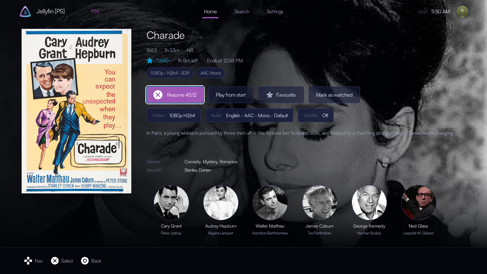 |  |
| 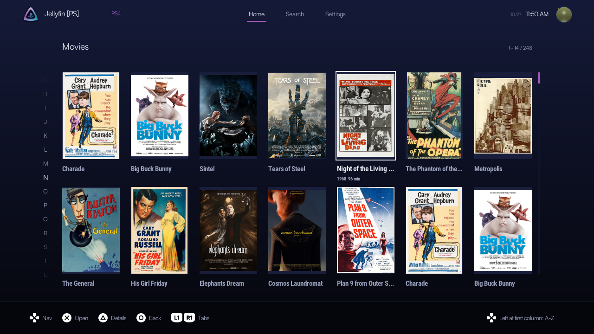 |  |
| 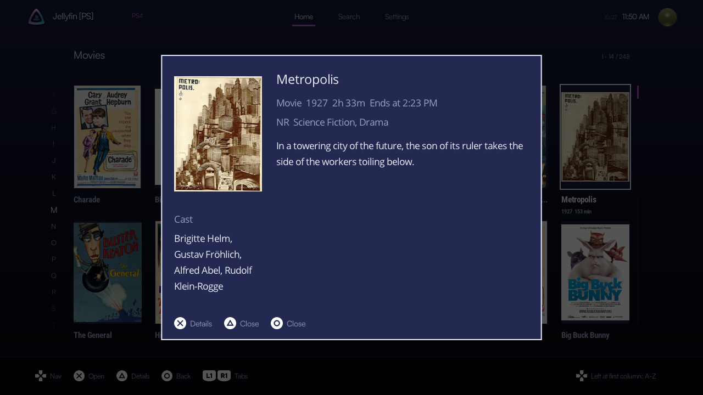 | 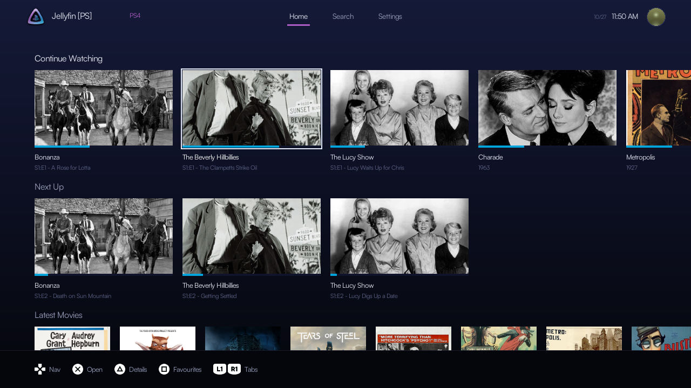 |
| 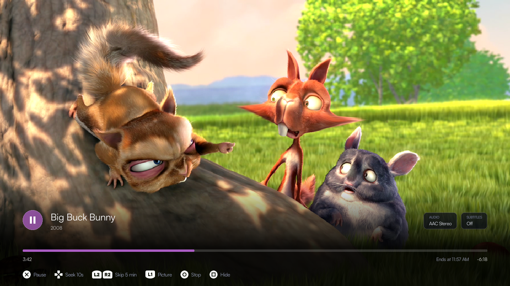 | 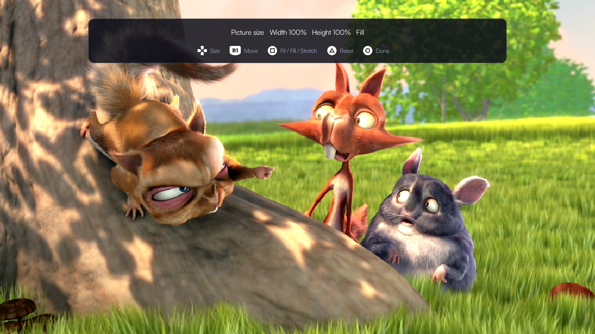 |
| 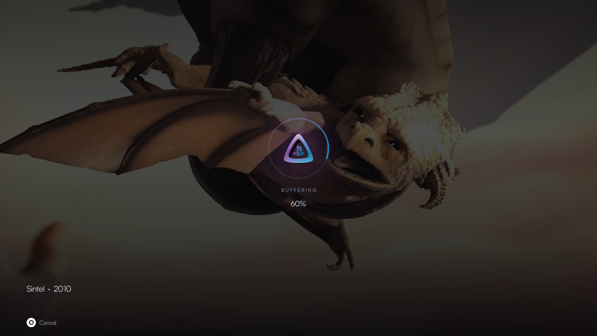 | 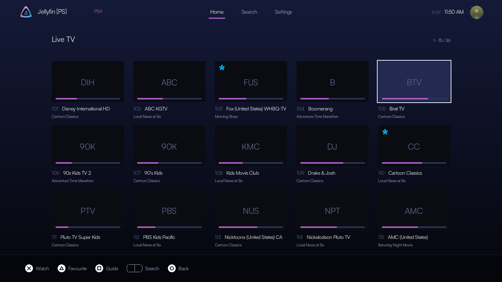 |

### Music visualizers

| | |
|---|---|
| 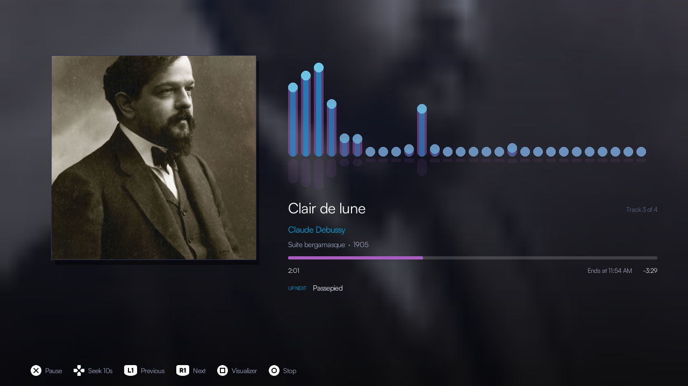 | 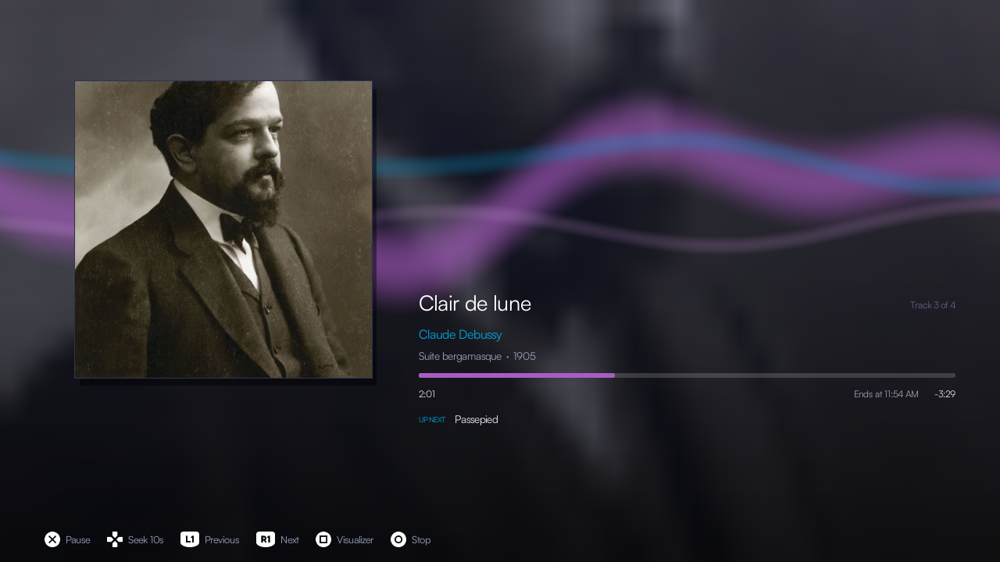 |
| 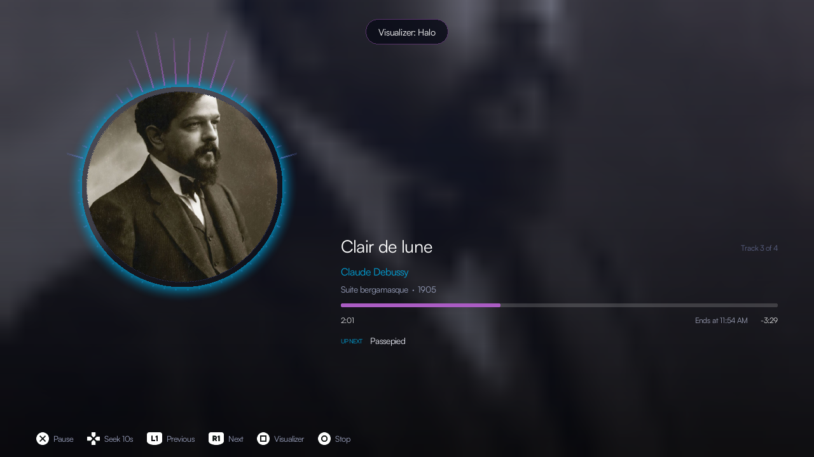 | 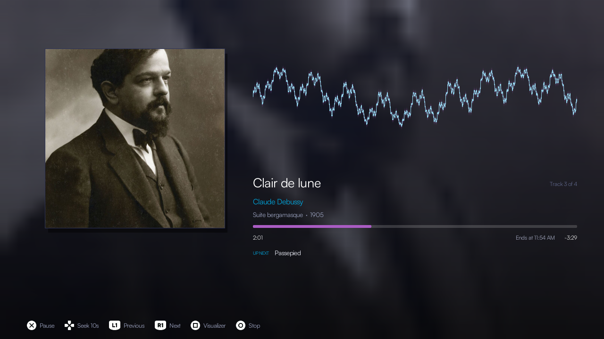 |

### Settings and more

| | |
|---|---|
| 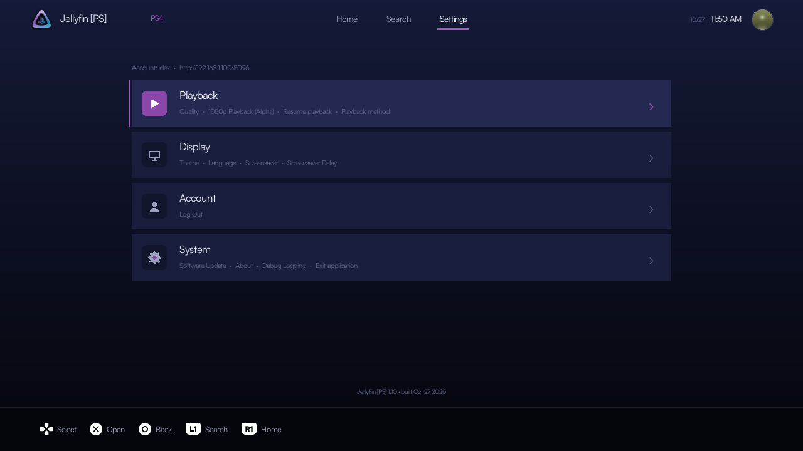 | 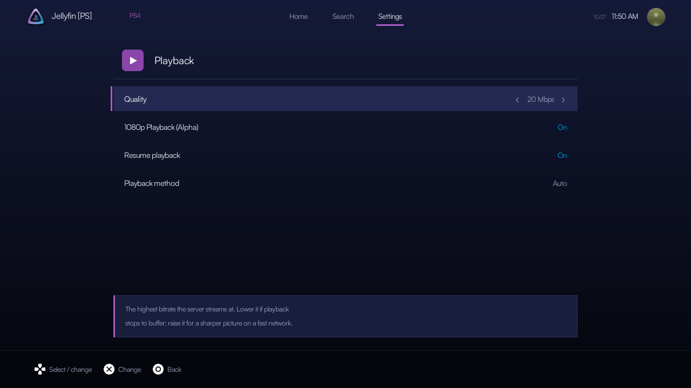 |
|  | 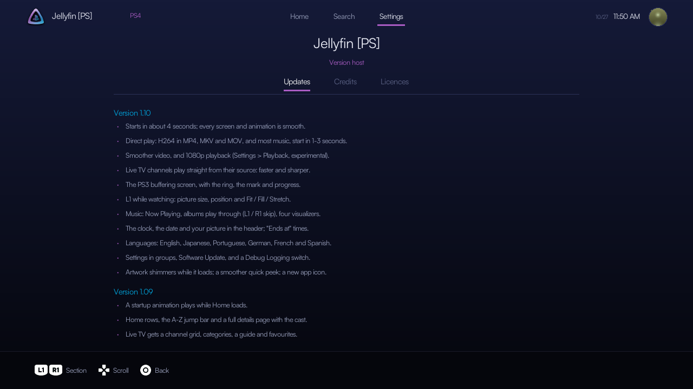 |

## Install

1. Copy `dist/v1.10/IV0000-JFPS40000_00-JELLYFINPS400000.pkg` to your PS4 and install it with your package installer. It installs over an earlier version and keeps your sign-in and settings.
2. Open **Jellyfin [PS]**, enter your server's full URL including the port (for example `http://192.168.1.100:8096`), then sign in with Quick Connect or your username and password.

### Updates

Settings › System › **Software Update** checks this project's latest GitHub release at every launch. When there is a newer version it offers to download it: the package is saved to `/data/pkg/JellyFin-PS4.pkg` and checked against its published size and SHA-256. Install it from the Package Installer (Debug Settings › Game › Package Installer, where GoldHEN lists `/data/pkg`), then start the app again. The app never installs anything by itself.

## Controls

| Button | Action |
|---|---|
| D-pad | Move |
| X | Open / select / play |
| Circle | Back |
| Triangle | Quick peek (libraries), favourite (Live TV) |
| Square | Favourites (Home), guide (Live TV), hide the bar (player), visualizer (music) |
| L1 / R1 | Home, Search, Settings; previous / next track (music) |
| L1 (player) | Picture size, position and Fit / Fill / Stretch |
| L2 / R2 | Live TV category; skip five minutes in the player |
| Options | Settings |
| Touchpad | Refresh Home, search channels (Live TV) |

## Playback

- **Direct play** (Settings › Playback › Playback method: *Auto*, the default): H264 films and shows in MP4, MKV and MOV, and MP3, FLAC, AAC / M4A, OGG, Opus and WAV music, are played as they are when the default audio track is used and no subtitles are burned in. Everything else is converted by the server to H264 / AAC. *Always transcode* converts everything; *Direct file* always plays the original.
- Video is decoded in software by MPV / FFmpeg. **1080p Playback** is on by default: films and shows up to 1920×1080 play directly, or are converted at 1080p; turn it off in Settings › Playback for 720p, which is lighter on the console. **Quality** (the highest bitrate the server streams at) defaults to 20 Mbps; lower it if playback stops to buffer on a slow network.
- Audio is stereo at 48 kHz. Audio and subtitle tracks are chosen on the details page before playing.
- **Live TV**: channels whose source is a plain web stream (an M3U tuner) play straight from that source in their best variant up to 720p; other channels, or one that will not start, go through the server.

## Files on the console

- Settings and session: `/data/JellyFin-PS4/user-<id>/`
- Diagnostic log, when Settings › System › **Debug Logging** is on (it is off by default; never passwords or tokens): `/data/JellyFin-PS4-logs/user-<id>.log`
- Downloaded updates: `/data/pkg/JellyFin-PS4.pkg`
- Extra themes: `/data/JellyFin-PS4/themes/`
- Put `0` in `bootanim.txt` in the user folder to turn the startup animation off.

## Building

From PowerShell in this folder:

```powershell
.\tools\build.ps1
```

This uses a WSL distribution (`kali-linux` by default) with Clang 18 and the project-local OpenOrbis toolchain and PS4 port libraries under `tools/`. The package is written to `dist/<version>/` and validated.

Host-side previews and tests run in WSL: `tools/test_ui_110.sh` renders every new screen and benchmarks it, and `tools/readme_shots.sh [playlist.m3u]` renders the screenshots above (Live TV takes its channel names from the playlist). Run `python tools/fetch_free_art.py` first to download their artwork.

The films, shows and music in the screenshots were chosen because their artwork is free to use: Blender Foundation open movies (Creative Commons), public-domain films and TV episodes, and public-domain classical works with portraits of their composers. Every image comes from Wikimedia Commons; authors, licences and sources are listed in [docs/screenshots/CREDITS.md](docs/screenshots/CREDITS.md).

## Credits and licence

Made by jw-notes. Jellyfin [PS] is free software under the GNU GPL, version 3 or later; see `LICENSE`.

Playback uses the PS4 builds of MPV (GPL 2+) and FFmpeg (LGPL / GPL 3) from [Switchfin](https://github.com/dragonflylee/switchfin/tree/ps4) (Apache 2.0), with SDL2, mbedTLS, dav1d, libass, FreeType, FriBidi, libpng, zlib and bzip2 under their own licences. The interface translations come from Jellyfin [PS] for PS3. Fonts: Satoshi (ITF Free Font License), Open Sans and Roboto Condensed (Apache 2.0), Noto Sans JP (SIL OFL 1.1). Button sprites by Kenney (CC0). Jellyfin logo CC BY-SA 4.0.
